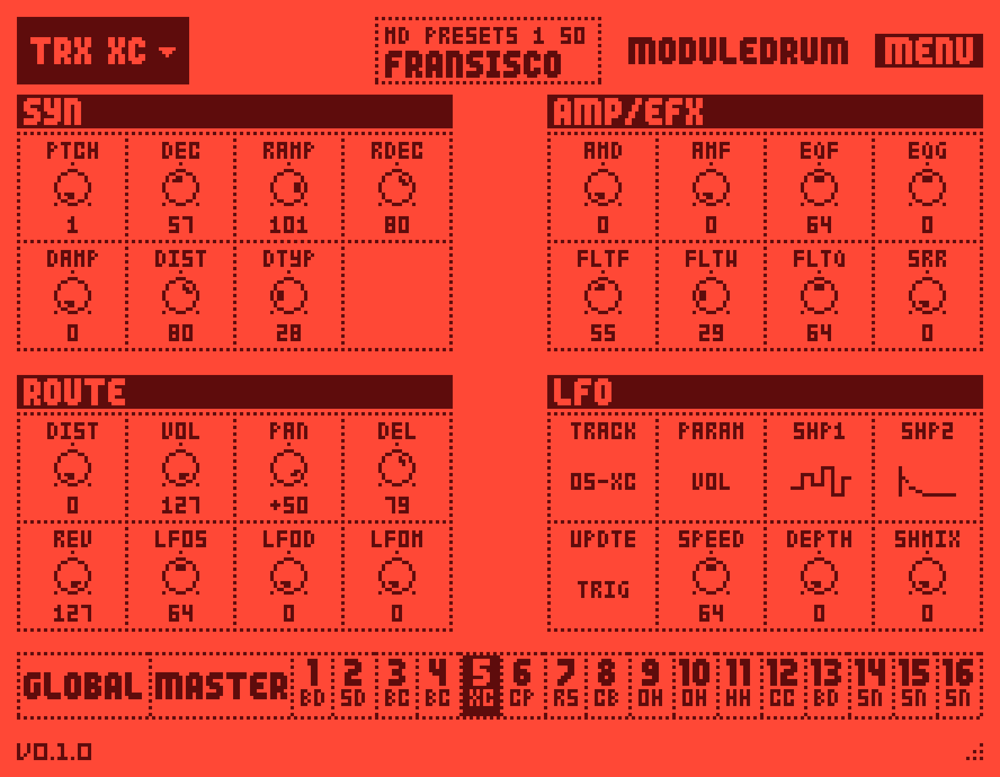
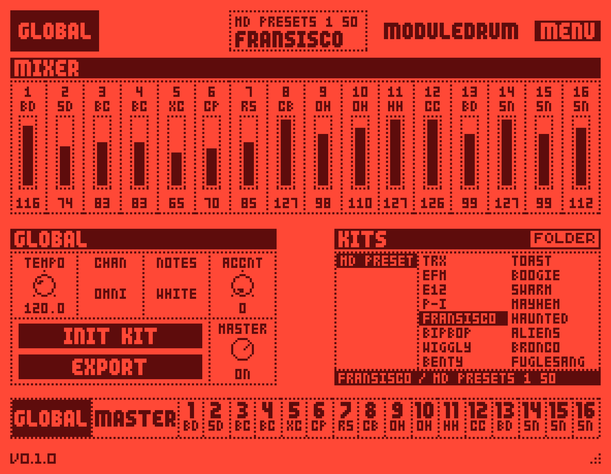
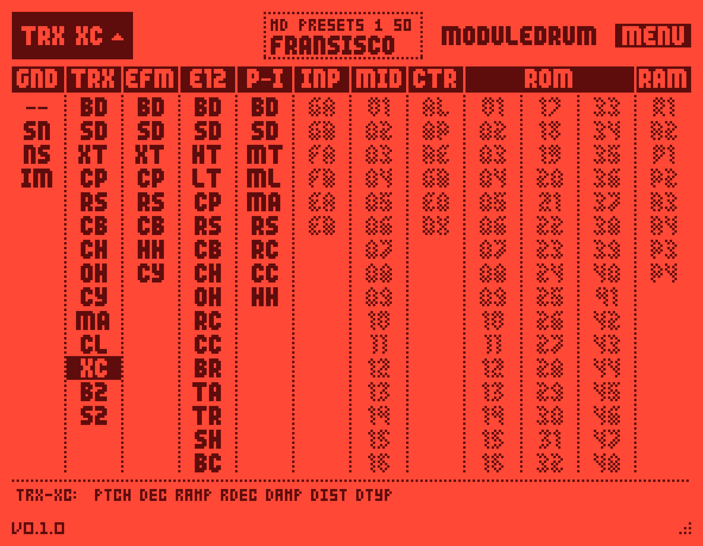
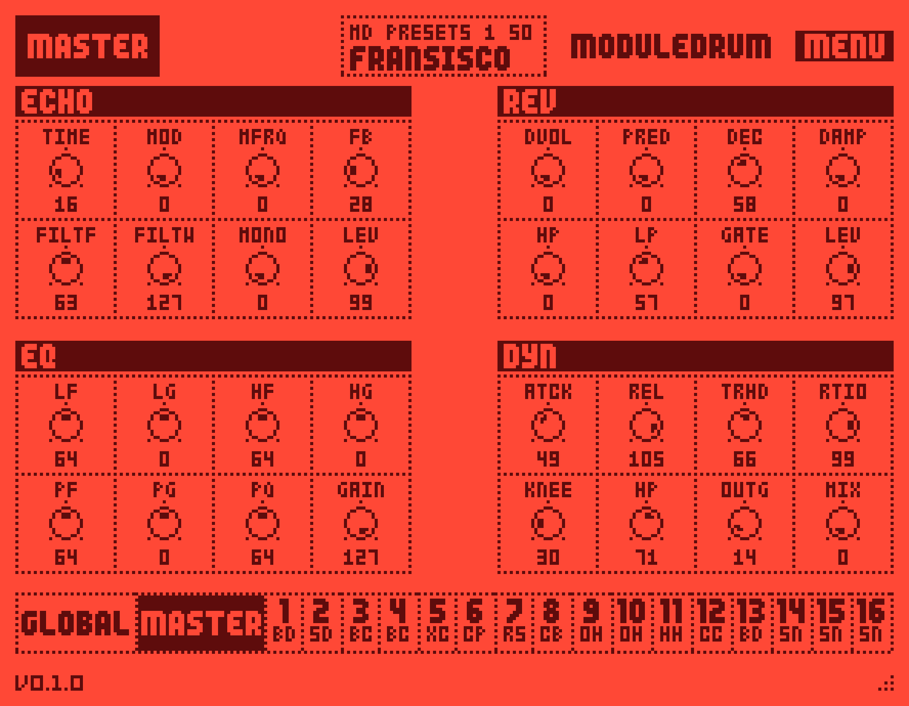

# Moduledrum

**Moduledrum** is a free, open-source, chip-level emulation of the Elektron Machinedrum SPS-1 UW as AU, VST3 and
standalone plugins for macOS. Like [Monomodule](https://github.com/shnolk/monomodule) does for the Monomachine, it
doesn't approximate the drum machine with new DSP code. It runs the Machinedrum's own voice DSP program in an emulated
Motorola DSP56300 and the OS's own machine code in an emulated ColdFire, on the engine of sd88me's
[Machinemodule for MPC OS](https://github.com/sd88me/mpc-vst-machinedrum).

<p align="center">
  
</p>

> **Moduledrum is not affiliated with, endorsed by or sponsored by Elektron.** "Elektron" and "Machinedrum" are
> trademarks of Elektron Music Machines MAQ AB, used here only to describe what Moduledrum emulates. Moduledrum
> contains no Elektron software. To make sound it needs the Machinedrum OS file, which you download from Elektron
> yourself (see [Getting the OS file](#getting-the-os-file)).

**Status:** early development. It plays, it saves, the editor is complete and the master effects run, but the ROM
machines are still missing (see [Known limitations](#known-limitations)). There is an installer and a CI build now, but no
download is published yet.

## What's included

| | Type | What it does |
|---|---|---|
| **Moduledrum** | Instrument (AU, VST3, standalone) | All 16 Machinedrum tracks in one instance, with a main mix through the Machinedrum's master effects (rhythm echo, gate box reverb, master EQ, dynamix), 16 track outputs and the reverb and delay sends as separate outputs. MIDI notes trigger tracks 1-16 as on the Machinedrum (the white keys from C2: 36 38 40 41 43 45 47 48 50 52 53 55 57 59 60 62), or chromatically (36-51 and 0-15) with the NOTE MAP parameter. The editor recreates the Machinedrum's LCD pages. |
| **Command-line tools** | `md-hash`, `md-machines`, `md-kits`, `md-plugin-check` | An audio hash of a fixed 16-track pattern to compare builds, the OS's machine table, the kits of a `.syx` dump (list, render one to WAV), and headless checks and snapshots of the plugin. |

Every knob of the 16 tracks (machine, the SYN, EFFECTS and ROUTING pages, LEV, the LFO page) and of the master effects
is a host parameter with the hardware's raw values and names, and the whole sound is saved with the project. Kits
import from and export to Machinedrum kit dumps (`.syx`) byte for byte, their master effects included.

The master effects are the Machinedrum's own: its mixer DSP's master program runs in a second emulated DSP behind the
mix, fed by the OS's own parameter code, so a kit sounds as it does on the hardware (and, as there, the master is not
level-neutral: the dynamix and the EQ's GAIN act on the dry mix too). The main output is the master section's; the
track outputs and the send outputs (the sends as they leave the mix, before the effects) are delayed to stay in step
with it, and the plugin reports that as 18 samples of latency at 44.1 kHz. The **MASTER FX** parameter (MASTER on the
GLOBAL page) switches the section off: the main output is then the dry mix, with no added latency.

The window can be resized from 50% to 200% with its proportions kept: drag the grip in the bottom-right corner. Every
Moduledrum window shares one size setting.

## The editor

The LCD is drawn with the OS file's own fonts and dials, in the layout of Machinemodule's MPC skin. MENU (top right) has
a Skin submenu with eight colour schemes for the LCD (Machinedrum, Inverted, Black on White, White on Black, Low
Contrast, Green, Amber and Blue LCD) and a custom pair of colours, shared by every Moduledrum window.

<p align="center">
  
  
</p>

<p align="center">
  
  <br><em>The MASTER tab: the loaded kit's master effects, ECHO, REV, EQ and DYN.</em>
</p>

- **Header:** the selected track's machine (click it for the machine picker), the loaded kit and its bank (click it for
  the kit browser).
- **Pages:** SYN | AMP/EFX over ROUTE | LFO for the selected track. SYN's knobs are named after the machine. Every cell
  is a knob on its host parameter: drag up or right to turn it up (shift: finer), use the mouse wheel (shift: one step),
  click the value to type it (or, for a named value such as LFO TRACK or UPDTE, to pick it from a list), double-click
  the dial for its default. Values are the raw ones the hardware shows (bipolar ones signed: PAN -1, EQG +20).
- **Strip** (bottom): GLOBAL, MASTER and tracks 1-16 with their machines. Click to select; click the selected track
  again to play it. Tracks flash when they play.
- **Machine picker:** the OS's machines by group. Greyed machines make no sound in this engine (INP, MID, CTR, RAM,
  and ROM, which needs samples from a real unit); a kit that uses one shows it, marked SILENT.
- **GLOBAL:** MIXER (the 16 tracks' LEV), TEMPO (used when the host gives none), CHAN (MIDI channel), NOTES (note map),
  ACCNT (accent), MASTER (the master effects on or off), INIT KIT, EXPORT (the current kit as a Machinedrum kit dump
  `.syx`), and KITS, the kit browser.
- **MASTER:** the master effects' four pages, in the hardware's order and with its labels: ECHO (rhythm echo: TIME MOD
  MFRQ FB FILTF FILTW MONO LEV), REV (gate box reverb: DVOL PRED DEC DAMP HP LP GATE LEV), EQ (LF LG HF HG PF PG PQ
  GAIN) and DYN (dynamix: ATCK REL TRHD RTIO KNEE HP OUTG MIX). A kit brings its own settings; turning a knob glides to
  the new value as the hardware does. The pages say OFF while MASTER is off.
- **Kits:** every `.syx` in `~/Library/Application Support/Moduledrum/Machinedrum/kits/` is a bank of kits (free slots
  are hidden); click a bank, then a kit to load it. Drop a `.syx` (a kit dump from C6, Transfer or an MD backup) anywhere
  on the editor to copy it there. FOLDER opens the folder; the browser notices files added or changed there.

## Getting the OS file

Moduledrum needs **Machinedrum OS 1.63**, a free download from Elektron's website (Machinedrum support / downloads):

1. Download `Elektron_SPS1-1UW_OS1.63.zip` from Elektron.
2. Unzip it. Inside is `Elektron_SPS1-1UW_OS1.63.syx`.
3. Open Moduledrum, open **MENU** (top right of the LCD), choose **Select OS File...** and pick that `.syx` file.

You only have to do this once: every Moduledrum instance shares the setting. The file stays where you put it.
Moduledrum reads it each time it starts and never copies it or redistributes it.

## Installing a release

Downloads are on the project's **Releases** page (and, for every commit, as artifacts of the `build` workflow on
GitHub Actions). One zip per platform, each with `VST3/`, `Standalone/`, `Tools/md-hash` (the exactness check, see
[docs/BETA-TESTING.md](docs/BETA-TESTING.md)) and the licence files; the macOS one has `AU/` too:

| Platform | Download | Plugins go to |
|---|---|---|
| macOS 12+ (Apple Silicon and Intel) | `Moduledrum-<version>-macos-universal.zip`, or the installer below | `~/Library/Audio/Plug-Ins/Components/` and `.../VST3/` |
| Windows 10 (1803+) and 11, x64 | `Moduledrum-<version>-windows-x64.zip` | `C:\Program Files\Common Files\VST3\` |
| Windows 11 on ARM (experimental) | `Moduledrum-<version>-windows-arm64.zip` | the same |
| Linux x64 and arm64 | `Moduledrum-<version>-linux-x64.zip`, `-linux-arm64.zip` | `~/.vst3/` |

There is no AU on Windows or Linux (Audio Units are macOS only), and no Windows installer or Authenticode signature
yet: SmartScreen warns on the first start of the standalone or `md-hash` (*More info*, *Run anyway*). On Linux the
emulator keeps the DSPs' memory in `/dev/shm`; a Docker container needs `--shm-size=1g`.

On macOS, `release/build_release.sh` (see [Making a release](#making-a-release)) also makes the two macOS downloads of
a release. Both hold the same three bundles:

- **`Moduledrum-<version>-macos-arm64.pkg`**, the installer. Open it, click through, and use *Customize* to leave out
  what you don't want. It installs for all users:

  | | Installed to |
  |---|---|
  | Audio Unit | `/Library/Audio/Plug-Ins/Components/Moduledrum.component` |
  | VST3 | `/Library/Audio/Plug-Ins/VST3/Moduledrum.vst3` |
  | Standalone app | `/Applications/Moduledrum.app` |

- **`Moduledrum-<version>-macos-arm64.zip`**, the bundles on their own, in `AU/`, `VST3/` and `Standalone/`, with the
  licence files. Copy them by hand: to `~/Library/Audio/Plug-Ins/Components` and `~/Library/Audio/Plug-Ins/VST3` for
  yourself only (the folders may not exist yet), or to the same folders under `/Library/` for everyone.

Then rescan the plugins in your host (Logic scans Audio Units at launch) and
[select your OS file](#getting-the-os-file) the first time Moduledrum opens. Nothing of Elektron's is in either file.

**Intel, Windows and Linux are in beta.** The macOS zip and the installer made with `-a universal` carry an Intel
(x86_64) slice, and the Windows and Linux x64 zips run the same x86-64 JIT back end, which has only run under Rosetta
so far (see [Known limitations](#known-limitations)). Every zip has `Tools/md-hash`, whose one-line output says whether
the emulation is exact on your machine: [docs/BETA-TESTING.md](docs/BETA-TESTING.md).

**Gatekeeper.** A release that is signed with a Developer ID certificate and notarized opens without questions. One
that is not (a build you made yourself, or a release published ad-hoc signed) is blocked while it carries the
download's quarantine mark: right-click the `.pkg` or the app and choose *Open*, then *Open* again; or allow it under
*System Settings > Privacy & Security > Open Anyway*; or remove the mark yourself, for the installer, or for the
unzipped bundles or the installed ones:

```bash
xattr -d com.apple.quarantine Moduledrum-<version>-macos-arm64.pkg
xattr -dr com.apple.quarantine /Applications/Moduledrum.app \
  /Library/Audio/Plug-Ins/Components/Moduledrum.component /Library/Audio/Plug-Ins/VST3/Moduledrum.vst3
```

## Building from source

### Requirements

Moduledrum builds on macOS, Linux and Windows. The commands below are for macOS; [Linux](#linux) and
[Windows](#windows) follow.

- macOS 12 or newer, with Xcode or the Xcode command line tools (`xcode-select --install`)
- CMake 3.22 or newer, Git and, optionally, [Ninja](https://ninja-build.org)
- An internet connection for the first configure: CMake downloads [JUCE](https://github.com/juce-framework/JUCE) 8.0.9.
  The two emulators are git submodules under `ext/`.

### macOS

```bash
git submodule update --init --recursive
cmake -S . -B build -G Ninja -DCMAKE_BUILD_TYPE=Release
cmake --build build
```

What you get:

| | |
|---|---|
| `build/src/plugin/MdOne_artefacts/Release/Standalone/Moduledrum.app` | standalone app |
| `build/src/plugin/MdOne_artefacts/Release/AU/Moduledrum.component`, `.../VST3/Moduledrum.vst3` | plugins, also copied to `~/Library/Audio/Plug-Ins/` (`MD_COPY_PLUGINS`) |
| `build/src/cli/md-hash`, `md-machines`, `md-kits`, `md-voicediag` | the command-line tools |
| `build/src/plugin/MdPluginCheck_artefacts/Release/MdPluginCheck` | `md-plugin-check`, the plugin's headless checks |

### Linux

On Debian or Ubuntu (other distributions: the same libraries under their own names):

```bash
sudo apt install build-essential cmake git ninja-build pkg-config \
  libasound2-dev libjack-jackd2-dev libfreetype-dev libfontconfig1-dev \
  libx11-dev libxcomposite-dev libxcursor-dev libxext-dev libxinerama-dev libxrandr-dev libxrender-dev \
  libgl1-mesa-dev libcurl4-openssl-dev libgtk-3-dev libwebkit2gtk-4.1-dev
git submodule update --init --recursive
cmake -S . -B build -G Ninja -DCMAKE_BUILD_TYPE=Release
cmake --build build
```

The build copies the VST3 to `~/.vst3/`; the standalone is `build/src/plugin/MdOne_artefacts/Release/Standalone/Moduledrum`.
x86-64 runs dsp56300's x64 JIT, aarch64 its aarch64 JIT (the one every hash in this README was established with).
The emulator keeps the DSPs' memory in `/dev/shm`: a Docker container needs `--shm-size=1g` or the engine stops at boot.

### Windows

Needs Visual Studio 2022 with the *Desktop development with C++* workload (Windows 10 1803 or later to run: the
emulator's memory mapper uses `VirtualAlloc2`). In a *Developer PowerShell for VS 2022*:

```powershell
git submodule update --init --recursive
cmake -S . -B build -G "Visual Studio 17 2022" -A x64
cmake --build build --config Release
ctest --test-dir build -C Release --output-on-failure
```

The VST3 is `build\src\plugin\MdOne_artefacts\Release\VST3\Moduledrum.vst3`: copy it to
`C:\Program Files\Common Files\VST3\`, or configure with `-DMD_COPY_PLUGINS=ON` from an administrator prompt. The
standalone is `...\Standalone\Moduledrum.exe`, `md-hash` is `build\src\cli\Release\md-hash.exe`. The C runtime is
linked statically, so nothing needs the Visual C++ redistributable. `-A ARM64` on a Windows-on-ARM machine builds for
it (experimental: dsp56300 selects its aarch64 JIT for MSVC's `_M_ARM64`, but it has not been run there).

### Build options

| Option | Default | Meaning |
|---|---|---|
| `MD_BUILD_PLUGIN` | `ON` | Build the plugin. `OFF` builds only the engine, the tests and the command-line tools. |
| `MD_BUILD_TESTS` | `ON` | Build the unit tests. |
| `MD_COPY_PLUGINS` | `ON` (`OFF` on Windows) | Copy the plugins to the user's plugin folders (`~/Library/Audio/Plug-Ins/`, `~/.vst3/`; the system VST3 folder on Windows) after each build. |
| `MD_OS_SYX` | *(empty)* | Path to your OS file. Used by the tests and the command-line tools. |
| `MD_USE_JIT` | `ON` | Run the emulated DSP on dsp56300's JIT. `OFF` uses its interpreter: the same audio, bit for bit, at about four times the CPU. The configure step applies `ext/patches/0001-dsp56300-md.patch` (JIT fixes), `0002` (memory) and `0003` (MSVC) to the `ext/dsp56300` checkout, so that submodule shows as modified. |
| `MD_CODESIGN_IDENTITY` | `-` | What the plugin bundles are signed with after each build: `-` is ad-hoc (runs on this Mac only), or the name of a "Developer ID Application" certificate. See [Signing](#signing). |
| `MD_CODESIGN_TIMESTAMP` | `none` | The signature's timestamp: `none` (offline), an empty value for Apple's server (notarization needs it), or a server URL. |
| `MD_VERSION` | `0.1.0` | The version of the bundles and of the installer (`release/build_release.sh -v` sets it). |
| `CMAKE_OSX_ARCHITECTURES` | *(this Mac's)* | `arm64;x86_64` builds a universal binary, see [below](#universal-binary-and-intel). |

### Signing

A Ninja or Makefile build leaves JUCE's bundles with only the linker's ad-hoc signature and none of the entitlements
that JUCE writes for them (`HARDENED_RUNTIME_OPTIONS` in `src/plugin/CMakeLists.txt`); only the Xcode generator applies
those. The emulated DSP needs them: under the hardened runtime, which notarization requires, a process without
`com.apple.security.cs.allow-jit` cannot map the JIT's executable memory (`md-hash` signed with the hardened runtime and
no entitlements stops with `JIT failed: 2 - InvalidArgument`). So the build signs the AU, the VST3 and the standalone
app again after linking them (`cmake/codesign.cmake`):

```
codesign --force --options runtime --timestamp=none --entitlements <JUCE's file> -s "$MD_CODESIGN_IDENTITY" <bundle>
```

and only then copies them to `~/Library/Audio/Plug-Ins/`. `codesign -d --entitlements - Moduledrum.app` shows the three
entitlements (allow-jit, allow-unsigned-executable-memory, disable-library-validation). `codesign` keeps entitlements in
executables only, so the AU and VST3 bundles carry the hardened-runtime flag but no entitlements: a plugin runs in its
host's process, and it is the host's entitlements that decide whether the JIT may run there. Changing
`MD_CODESIGN_IDENTITY` and building again signs the bundles again.

### Universal binary and Intel

```bash
cmake -S . -B build-universal -G Ninja -DCMAKE_BUILD_TYPE=Release -DCMAKE_OSX_ARCHITECTURES="arm64;x86_64"
```

builds the plugins, the standalone app and the command-line tools for both architectures (dsp56300 and asmjit select
their JIT back end by compiler macro, so one configure is enough; `lipo -archs` shows both). **The x86_64 slice is not
trusted yet:** run under Rosetta, its `md-hash` and all ten tests are right, but the JIT lockstep check finds the x64 JIT
leaving the Z flag set after an LSL loop (a two-line fix is known and still has to go into `ext/patches`; details in
[docs/DEVELOPMENT.md](docs/DEVELOPMENT.md)), and no Intel Mac has run it. Treat it as experimental. To run
the tests of the x86_64 slice on Apple Silicon (an arm64 CMake's `ctest` cannot be started with `arch -x86_64`), let
CMake start every test through Rosetta:

```bash
cmake -S build-universal -B build-universal "-DCMAKE_CROSSCOMPILING_EMULATOR=arch;-x86_64"
MD_OS_SYX=... MD_KITS_SYX=... ctest --test-dir build-universal --output-on-failure
```

(or `arch -x86_64 build-universal/src/cli/md-hash <OS>` for the golden hash alone; `-UCMAKE_CROSSCOMPILING_EMULATOR`
puts it back.)

### Making a release

```bash
release/build_release.sh [-v version] [-s identity] [-n] [-a arm64|universal]
```

configures a clean Release build in `build-release/`, builds it, runs the tests that need no OS file, checks the
signatures, and writes `dist/Moduledrum-<version>-macos-<arm64|universal>.pkg` (component packages for the AU, the VST3
and the app, joined by a distribution, installing to `/Library/Audio/Plug-Ins/` and `/Applications`) and the `.zip` of
the three bundles, with a `.sha256` file. It installs nothing. With no options the build is arm64 and ad-hoc signed,
and the script says that notarization was skipped. `-a universal` adds the x86_64 slice (see above). For a signed and
notarized release you need an Apple Developer account and, in your keychain, the certificates *Developer ID
Application* and *Developer ID Installer*:

```bash
# once: store the notarization credentials in the keychain under a profile name (an app-specific password for your
# Apple ID, made at appleid.apple.com, or an App Store Connect API key with --key/--key-id/--issuer)
xcrun notarytool store-credentials "moduledrum-notary" --apple-id you@example.com --team-id TEAMID --password xxxx-xxxx-xxxx-xxxx

export MD_NOTARY_PROFILE=moduledrum-notary
export MD_INSTALLER_IDENTITY="Developer ID Installer: Your Name (TEAMID)"
release/build_release.sh -v 0.1.0 -s "Developer ID Application: Your Name (TEAMID)" -n
```

`-n` signs with Apple's timestamp, submits the installer with `notarytool submit --wait`, staples the ticket to it
and to the three bundles, and only then writes the `.zip`. `MD_CMAKE_ARGS` adds arguments to the configure step (for
example `-DFETCHCONTENT_SOURCE_DIR_JUCE=<a JUCE 8.0.9 checkout>`). Nothing derived from the OS file is ever packaged:
the plugin asks for it at run time. GitHub Actions (`.github/workflows/build.yml`) builds and tests every push on
macOS (universal), Linux (x64 and arm64) and Windows (x64; arm64 as an experiment) and uploads one zip per platform,
made by `cmake/stage_release.cmake` (the plugins, the standalone, `md-hash` and the licence files; the same script
works locally: `cmake -DBUILD_DIR=build -DOUT_DIR=dist -DPLATFORM=linux -P cmake/stage_release.cmake`). The tests
that need the OS file are skipped there. A `v*` tag attaches the zips to a draft release.

### Tests

```bash
MD_OS_SYX=/path/to/Elektron_SPS1-1UW_OS1.63.syx ctest --test-dir build --output-on-failure
```

Without the OS file, the tests that run the engine are reported as skipped and the rest still run (that is what CI does).
`MD_KITS_SYX=/path/to/a kit dump .syx` adds the kit cases: kit files decoded and re-encoded byte for byte, a kit through
the plugin's parameters and saved state, and the editor's kit browser. `plugin-master` checks the master effects in
the plugin (their hashes, the latency, every output in step with the main one); `plugin-editor` drives the editor
headlessly; `plugin-rt` checks that `processBlock` makes no heap allocation (macOS);
`md-plugin-check --snapshot <dir>` renders its pages to PNG for review (they show artwork read from your OS file, so
don't commit them).

The golden test checks that `md-hash`'s pattern still renders bit for bit what it did: `build/src/cli/md-hash <OS.syx>`
prints `hash 04ef1db4fe767721` with OS 1.63, with the JIT and with the interpreter, and `MD_GROUPS=2` must print the same.
`MD_JIT_LOCKSTEP=1` (JIT builds) runs a second copy of the voice DSP on the interpreter next to every JIT one and stops
at the first register that differs.

## How it works

- **OS file.** `src/core/md/Firmware` unpacks the user's OS file: the sysex transport, the flash container and the
  compressed sections. From these come the ColdFire OS image, the voice DSP's program and the tables the effects use.
- **Voices.** `VoiceEngine` runs the Machinedrum's voice DSP (DSP2) program in the dsp56300 emulator. A small harness
  replaces the hardware's link DMA and frame sync (the Monomodule approach): every 32-sample block renders all 16
  voices and reads them out over the host port.
- **Machine code.** `MachineRunner` runs the OS's own per-machine coefficient functions, ColdFire code from the OS
  image, in the mc68k emulator: the 8 SYN values go in, and the voice DSP's slot words come out.
- **Host model.** `HostModel` does the main processor's job around them, as the OS's tick routine does: triggers,
  machine assignment, parameter smoothing and the LFOs (the OS's own routines again).
- **Effects and mix.** `TrackFx` and `Mixer` are the mixer DSP's (DSP1) per-track chain (AMD, EQ, filter, SRR,
  distortion) and its mix (pan law, VOL, the reverb and delay sends, the individual outputs), translated to native C++
  and bit-exact with the DSP code. Their tables are read from the OS file.
- **Master effects.** `MasterFx` runs DSP1's own master section (rhythm echo, gate box reverb, master EQ, dynamix),
  unchanged, on a second emulated DSP56300 behind the mix; `HostModel` turns a kit's 32 master bytes into the 38 words it
  reads with the OS's own smoothing and parameter code, one group per control tick as on the hardware.
- **Plugin.** `src/plugin` holds the plugin. The engine runs at 44.1 kHz inside `processBlock`; at other host rates
  Monomodule's band-limited resampler converts it. `src/core/md/library` decodes and re-encodes Machinedrum kit dumps.
  The editor draws the LCD with the fonts and dials from your OS file. Without an OS file it falls back to a built-in
  stand-in face.

The engine in `src/core/md` is sd88me's, vendored from Machinemodule for MPC OS
([THIRD_PARTY_NOTICES.md](THIRD_PARTY_NOTICES.md) has the details).

## Known limitations

- **Master effects:** the control machines (CTR-RE, CTR-GB, CTR-EQ, CTR-DX), which drive them from a track, are not
  modelled. The section runs every block whether anything plays or not, and its second emulated DSP takes about
  215 MB more memory per instance (an engine is ~300 MB with it, ~90 MB without; most of it is the JIT's tables).
- **ROM machines and the factory kits** need the sample flash of a real unit, which is not part of the OS file. INP,
  MID, CTR and RAM machines are silent too.
- **No sequencer.** Moduledrum plays the 16 tracks from MIDI notes. Patterns, songs, parameter locks and trigger groups
  are not modelled.
- **CPU.** The emulated DSPs run on dsp56300's JIT, bit-exact with its interpreter. On Apple Silicon, 16 tracks cost
  about 5% of one core on `md-hash`'s sparse pattern and about 7% with every track retriggered 8 times per beat, and
  the master effects add about 2% (9% in all; the interpreter: 18% and 32% without them). An idle instance still runs
  the whole DSP every block.
- **x86-64 is in beta.** Apple Silicon (and Linux aarch64) run the aarch64 JIT back end, the one every hash above
  was established with. Intel Macs, Windows x64 and Linux x64 run dsp56300's x64 back end, which has had one bug fixed
  by this project (fix 4 of `ext/patches/0001-dsp56300-md.patch`, found in lockstep under Rosetta) and has not yet
  run on a real x86-64 machine. `Tools/md-hash` in every download answers that in one line
  ([docs/BETA-TESTING.md](docs/BETA-TESTING.md)); 32-bit ARM and other architectures have no JIT and are out of scope.

## Settings and data

Moduledrum keeps its settings and kit folder in `~/Library/Application Support/Moduledrum/Machinedrum/`
(`settings.xml` and `kits/`).

## Development

Work is planned and logged with [clew](https://github.com/npatten/clew). `.clew/increments/` holds the open work in
priority order (`.clew/path.md`), and `.clew/archive/` the finished increments with their decisions, measurements and
regression hashes. With clew installed, `clew list` shows what's next.

[docs/DEVELOPMENT.md](docs/DEVELOPMENT.md) is the summary for anyone picking the project up: where the code comes
from, the regression hashes and how to run the checks, what has been measured, the decisions that were made and why
(including the JIT work and the dsp56300 patch), and the open work.

## Licence

Moduledrum is free software: you can redistribute it and/or modify it under the terms of the
**GNU Affero General Public License v3.0** (see [LICENSE](LICENSE)). Anyone who distributes Moduledrum, modified or
not, must pass on these same rights and make the corresponding source code available.

It is built on [JUCE](https://github.com/juce-framework/JUCE) (AGPLv3), [dsp56300](https://github.com/dsp56300/dsp56300)
(GPLv3) and mc68k (GPLv3), among others. [THIRD_PARTY_NOTICES.md](THIRD_PARTY_NOTICES.md) lists every dependency, its
licence and the code adapted from Monomodule and Machinemodule for MPC OS.

## Credits

Moduledrum is made by [chriskrofchak](https://github.com/chriskrofchak).

It stands on the work of:

- **Elektron**, for the Machinedrum. Its OS and its sound belong to them, and Moduledrum ships none of it.
- **sd88me's [Machinemodule for MPC OS](https://github.com/sd88me/mpc-vst-machinedrum)**, the Machinedrum engine at the
  heart of Moduledrum: the host model, the machine runner, the voice engine, the track effects and mix bit-exact with
  the hardware's DSP code, the parameter layout, the kit-dump parsing, where the OS file keeps its LCD artwork, and the
  skin layout the editor follows. Moduledrum is, in large part, that work brought to the desktop.
- **shnolk's [Monomodule](https://github.com/shnolk/monomodule)**, the model this project follows: the approach (the
  machine's own DSP in an emulator, a host model for the main processor) and the plugin shell, the LCD editor drawn
  with the OS file's own fonts, the resampler, the shared settings and the OS-file picker.
- **[dsp56300](https://github.com/dsp56300/dsp56300)**, the DSP56300 emulator that runs the voice DSP, built from
  sd88me's fork [sd88me/dsp56300](https://github.com/sd88me/dsp56300), which includes Monomodule's dsp56300 patch.
- **[gearmulator](https://github.com/dsp56300/gearmulator)**'s mc68k, the 68k-family emulator that runs the OS's machine
  code, in the fork [joelanders/mc68k-md-mm](https://github.com/joelanders/mc68k-md-mm) by Joe Landers, whose
  full-system Machinedrum emulation [gearmulator-md-mm](https://github.com/joelanders/gearmulator-md-mm) is the
  reference the engine was checked against.
- **[Musashi](https://github.com/kstenerud/Musashi)** by Karl Stenerud, the CPU core inside mc68k.
- **[JUCE](https://github.com/juce-framework/JUCE)**, the plugin and UI framework.
- **[AsmJit](https://github.com/asmjit/asmjit)**, the JIT back end of dsp56300.
- **[MCL](https://github.com/jmamma/MCL)** by jmamma, whose Machinedrum kit layout the kit codec was checked against.
- **[elektron-firmware-tool](https://github.com/mischa85/elektron-firmware-tool)** by mischa85, credited by Monomodule for
  its work on the Elektron OS file format. Moduledrum's OS-file decoder descends from Monomodule's.
- **[clew](https://github.com/npatten/clew)** by npatten, a fast, local, command-line issue tracker made for working
  with coding agents. Every increment of Moduledrum, from the first check that the engine builds on a Mac to the
  editor's last page, was planned, worked through and closed in it, and `.clew/` keeps the whole story, dead ends
  included. It kept a project with a lot of moving parts small, steady and tested at every step. Highly recommended.
- Built with [Claude Code](https://claude.com/claude-code).

Bug reports and pull requests are welcome.
